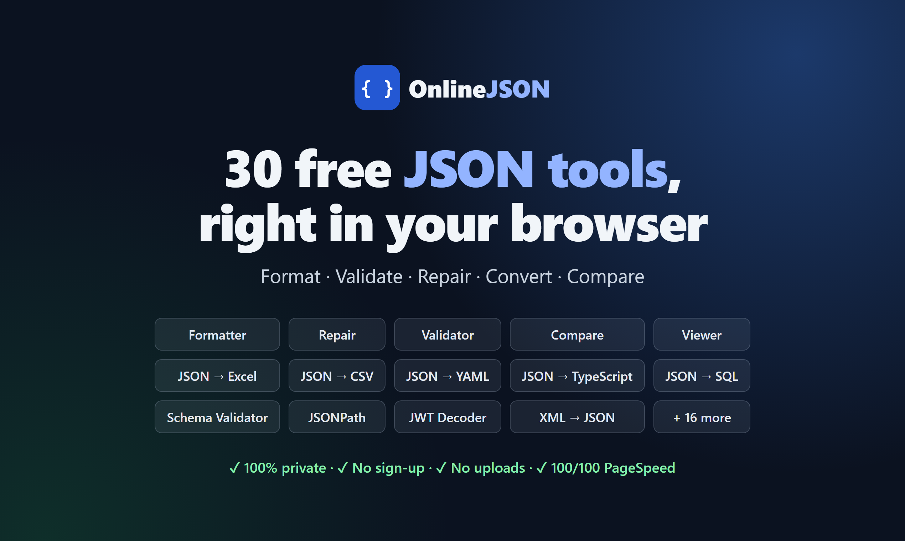
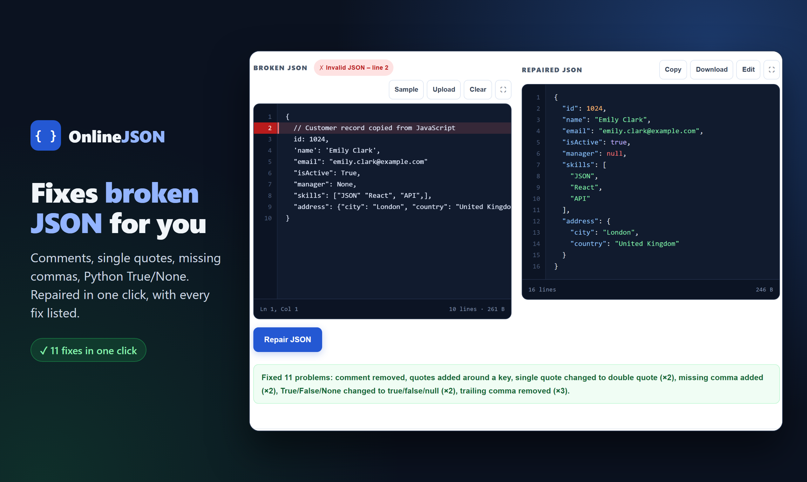

# Online JSON Formatter

**Live site: [online-json-formatter-ten.vercel.app](https://online-json-formatter-ten.vercel.app/)**

30 free JSON tools that run entirely in your browser: format, validate, repair, compare and convert JSON. No uploads, no sign-up, no ads in the way.



## Why use it

- **Private:** your JSON is processed locally in your browser and never sent to a server
- **Auto-repair:** fixes missing commas, single quotes, comments, trailing commas, unquoted keys and Python `True`/`None`, and lists every fix it made
- **Code, Tree and Graph views** for exploring large JSON
- **Fast:** 100/100 Google PageSpeed score on mobile
- Free, works on desktop and mobile, light and dark mode



## Tools

### Format & check

| Tool | What it does |
|---|---|
| [JSON Formatter](https://online-json-formatter-ten.vercel.app/) | Beautify JSON and auto-fix common mistakes. |
| [JSON Viewer](https://online-json-formatter-ten.vercel.app/json-viewer) | Explore JSON as a collapsible tree. |
| [JSON Validator](https://online-json-formatter-ten.vercel.app/json-validator) | Find the exact line and column of any error. |

### Convert

| Tool | What it does |
|---|---|
| [JSON to CSV](https://online-json-formatter-ten.vercel.app/json-to-csv) | Turn JSON into a spreadsheet file. |
| [CSV to JSON](https://online-json-formatter-ten.vercel.app/csv-to-json) | Turn spreadsheet rows into clean JSON. |
| [JSON to Excel](https://online-json-formatter-ten.vercel.app/json-to-excel) | Download JSON as a real .xlsx file. |
| [JSON to XML](https://online-json-formatter-ten.vercel.app/json-to-xml) | Convert JSON into well-formed XML. |
| [XML to JSON](https://online-json-formatter-ten.vercel.app/xml-to-json) | Convert XML documents into JSON. |
| [JSON to YAML](https://online-json-formatter-ten.vercel.app/json-to-yaml) | Convert JSON into readable YAML. |
| [YAML to JSON](https://online-json-formatter-ten.vercel.app/yaml-to-json) | Convert YAML config files into JSON. |
| [JSON to SQL](https://online-json-formatter-ten.vercel.app/json-to-sql) | Create CREATE TABLE and INSERT statements. |
| [SQL to JSON](https://online-json-formatter-ten.vercel.app/sql-to-json) | Turn SQL INSERT statements into JSON. |

### Generate code

| Tool | What it does |
|---|---|
| [JSON to TypeScript](https://online-json-formatter-ten.vercel.app/json-to-typescript) | Generate TypeScript interfaces from JSON. |
| [JSON to Python](https://online-json-formatter-ten.vercel.app/json-to-python) | Generate dataclasses or Pydantic models. |
| [JSON to Java](https://online-json-formatter-ten.vercel.app/json-to-java) | Generate Java classes or records. |
| [JSON Schema Generator](https://online-json-formatter-ten.vercel.app/json-schema-generator) | Create a JSON Schema from an example. |

### Check & query

| Tool | What it does |
|---|---|
| [JSON Schema Validator](https://online-json-formatter-ten.vercel.app/json-schema-validator) | Check JSON against a JSON Schema. |
| [JSONPath Tester](https://online-json-formatter-ten.vercel.app/json-path) | Find values with JSONPath queries. |
| [JSON Size Calculator](https://online-json-formatter-ten.vercel.app/json-size-calculator) | See bytes, minified and gzip size. |

### Compare

| Tool | What it does |
|---|---|
| [JSON Compare](https://online-json-formatter-ten.vercel.app/json-compare) | See what was added, removed or changed. |
| [Text Compare](https://online-json-formatter-ten.vercel.app/text-compare) | Compare any two texts line by line. |

### Clean up

| Tool | What it does |
|---|---|
| [JSON Minifier](https://online-json-formatter-ten.vercel.app/json-minifier) | Remove spaces to make JSON smaller. |
| [JSON Repair](https://online-json-formatter-ten.vercel.app/json-repair) | Fix broken JSON automatically. |
| [JSON Sorter](https://online-json-formatter-ten.vercel.app/json-sorter) | Sort JSON keys from A to Z. |
| [XML Formatter](https://online-json-formatter-ten.vercel.app/xml-formatter) | Beautify, validate or minify XML. |
| [YAML Formatter](https://online-json-formatter-ten.vercel.app/yaml-formatter) | Validate and beautify YAML. |

### Encode & decode

| Tool | What it does |
|---|---|
| [JSON Escape / Unescape](https://online-json-formatter-ten.vercel.app/json-escape) | Escape JSON into a string, or back. |
| [Base64 Encode / Decode](https://online-json-formatter-ten.vercel.app/base64-encode-decode) | Encode text to Base64, or decode it. |
| [URL Encode / Decode](https://online-json-formatter-ten.vercel.app/url-encode-decode) | Percent-encode text for links, or decode it. |
| [JWT Decoder](https://online-json-formatter-ten.vercel.app/jwt-decoder) | Read the header and payload of a JWT. |

[See all tools on one page →](https://online-json-formatter-ten.vercel.app/tools)

## Guides

- [What Is JSON?](https://online-json-formatter-ten.vercel.app/what-is-json)
- [JSON Syntax Rules](https://online-json-formatter-ten.vercel.app/json-syntax-rules)
- [Common JSON Errors](https://online-json-formatter-ten.vercel.app/common-json-errors)
- [Unexpected Token in JSON](https://online-json-formatter-ten.vercel.app/unexpected-token-in-json)
- [How to Pretty Print JSON](https://online-json-formatter-ten.vercel.app/pretty-print-json)
- [JSON Comments](https://online-json-formatter-ten.vercel.app/json-comments)
- [JSON in Python](https://online-json-formatter-ten.vercel.app/json-in-python)
- [JSON.parse in JavaScript](https://online-json-formatter-ten.vercel.app/javascript-json-parse)
- [JSON Lines (JSONL)](https://online-json-formatter-ten.vercel.app/json-lines)
- [How to Open a JSON File](https://online-json-formatter-ten.vercel.app/how-to-open-json-file)
- [JSON vs XML](https://online-json-formatter-ten.vercel.app/json-vs-xml)
- [JSON vs YAML](https://online-json-formatter-ten.vercel.app/json-vs-yaml)
- [JSON to CSV in Python](https://online-json-formatter-ten.vercel.app/json-to-csv-python)
- [Convert JSON to Excel](https://online-json-formatter-ten.vercel.app/convert-json-to-excel)

## Free JSON datasets

- [All datasets](https://online-json-formatter-ten.vercel.app/datasets): Browse every free JSON dataset.
- [HTTP Status Codes](https://online-json-formatter-ten.vercel.app/http-status-codes-json): All HTTP status codes with meanings.
- [Programming Languages](https://online-json-formatter-ten.vercel.app/programming-languages-json): Popular languages with years and creators.
- [File Extensions & MIME Types](https://online-json-formatter-ten.vercel.app/file-extensions-json): Content types for common files.
- [package.json Template](https://online-json-formatter-ten.vercel.app/package-json-template): A modern package.json, explained.
- [tsconfig.json Template](https://online-json-formatter-ten.vercel.app/tsconfig-json-template): Recommended TypeScript settings.

## Built with

- [React](https://react.dev/) and [Vite](https://vite.dev/), prerendered at build time
- Hosted on [Vercel](https://vercel.com/)

## Run locally

```bash
npm install
npm run dev
```

Build for production:

```bash
npm run build
```

## Links

- [About](https://online-json-formatter-ten.vercel.app/about)
- [Privacy Policy](https://online-json-formatter-ten.vercel.app/privacy-policy)
